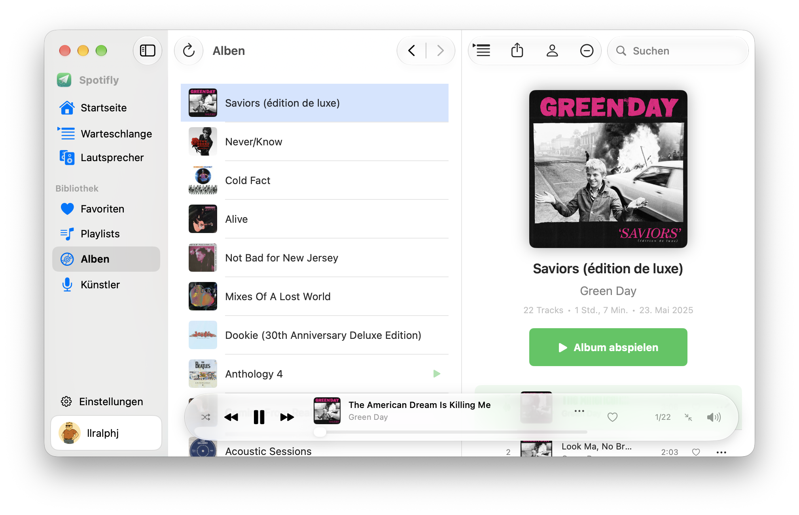
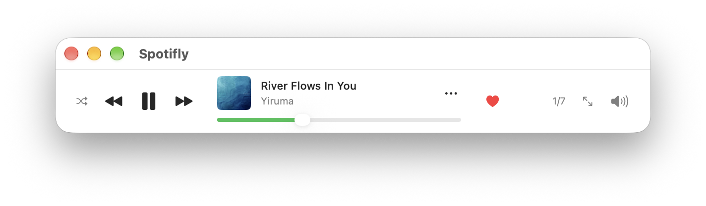

# Spotifly

A lightweight Spotify player for macOS.

**[Website](https://ralph.github.io/Spotifly/)** · **[Download](https://github.com/ralph/Spotifly/releases/latest)**

## Screenshots

### Album View


### Miniplayer


## Installation

### Direct Download

1. Download the [latest release](https://github.com/ralph/spotifly/releases/latest)
2. Extract the ZIP file
3. Move `Spotifly.app` to your Applications folder
4. Open Spotifly from Applications

### Homebrew

```bash
brew install ralph/spotifly/spotifly
```

## Requirements

- macOS 27 or later
- Spotify Premium account
- A Soloist key from Spotify, to play on this Mac

## Features

- Lightweight and fast
- Native macOS app built with SwiftUI
- Plays on this Mac through Spotify's own Soloist player, and drives your phone and speakers over Spotify Connect
- Your library: playlists, albums, followed artists and liked songs
- Queue management with drag-and-drop reordering
- Playback controls
- Search functionality
- Favorites management

## Signing In

1. Open Spotifly
2. Click **Connect with Spotify**
3. Authorize Spotifly in the browser tab that opens

That signs you in. You can browse, and play on your other Spotify Connect devices, from here.

## Playing on This Mac

Spotifly plays through Soloist, Spotify's own player. Spotifly downloads it from Spotify and runs it. Set it up once:

1. Open **Settings → Playback**
2. Click **Get a Key from Spotify**, and create a key on Spotify's Soloist dashboard
3. Paste the key, and click **Download and Use**
4. In the Spotify app on your phone, on the same network, choose **Spotifly** once

## Keyboard Shortcuts

### Playback

| Shortcut | Action |
|----------|--------|
| Space | Play / Pause |
| ⌘ → | Next track |
| ⌘ ← | Previous track |
| ⌘ L | Like / Unlike current track |

### Navigation

| Shortcut | Action |
|----------|--------|
| ⌘ 1 | Go to Favorites |
| ⌘ 2 | Go to Playlists |
| ⌘ 3 | Go to Albums |
| ⌘ 4 | Go to Artists |
| ⌘ F | Focus search field |
| ⌘ R | Refresh (on startpage) |

## Development

See [DEVELOPMENT.md](DEVELOPMENT.md) for build instructions and architecture documentation.

## Acknowledgements

Spotifly's Spotify Connect is written in Swift, following the protocol work of
[librespot](https://github.com/librespot-org/librespot).
Playback on this Mac is Spotify's [Soloist](https://developer.spotify.com/dashboard/soloist),
which Spotifly downloads from Spotify.

## License

This project is licensed under the MIT License - see the [LICENSE](LICENSE) file for details.
